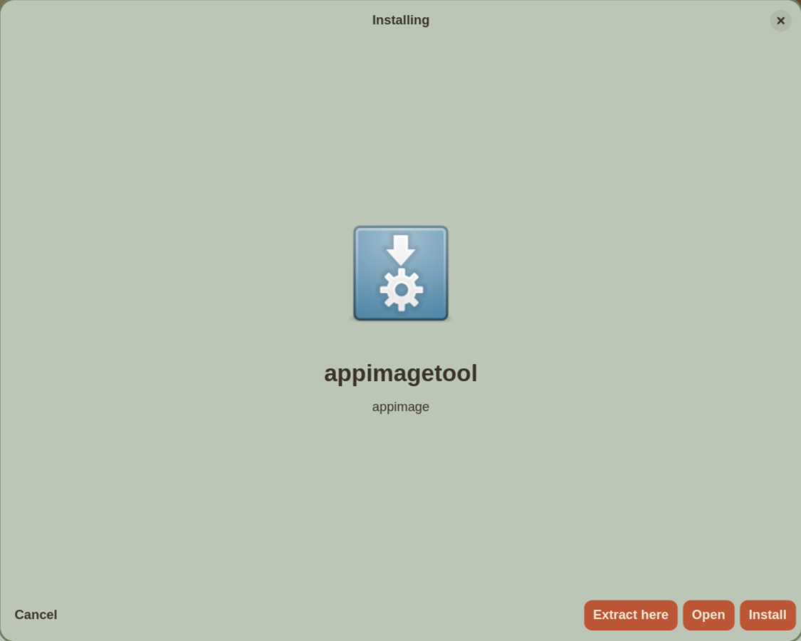
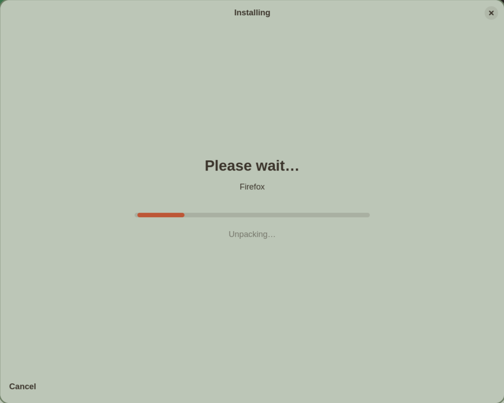
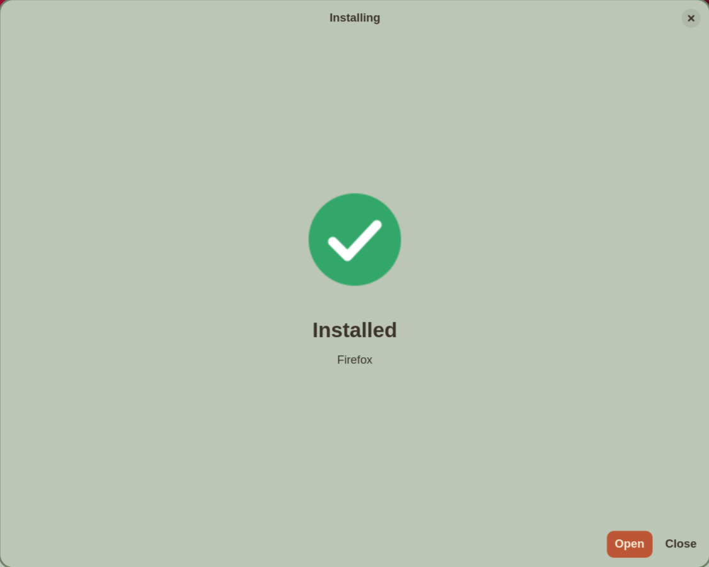
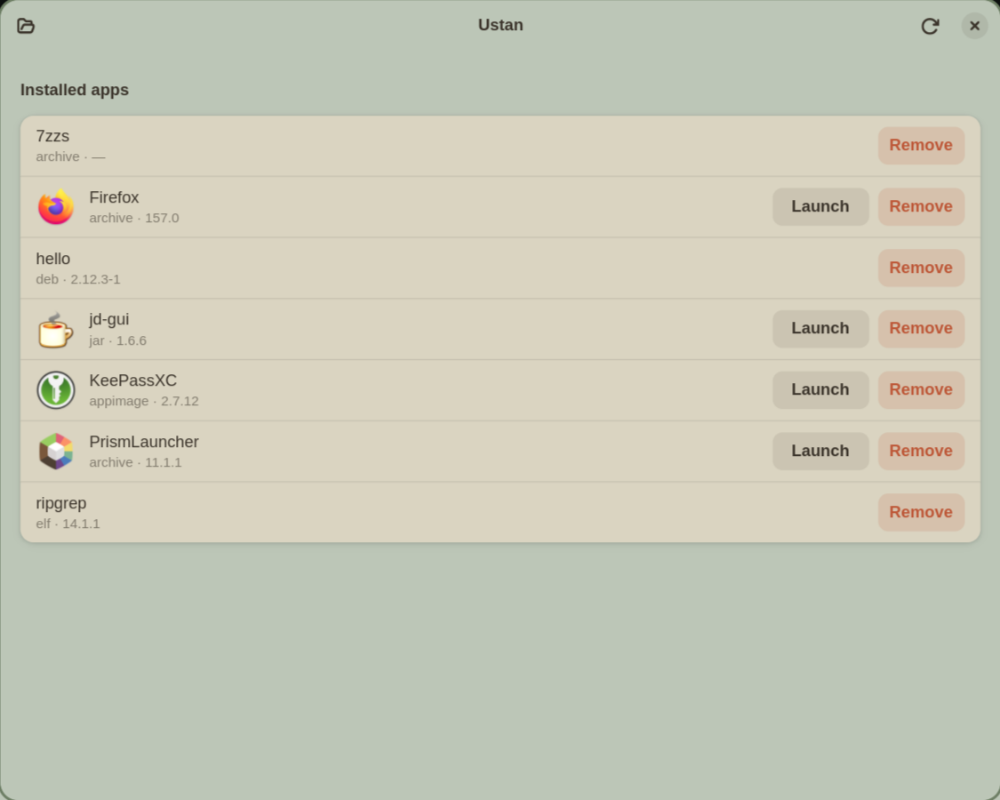

# ustan

A Windows-style installer for Linux: open a package, see what it is, press *Install*.
Everything goes into your home directory — no root — with a menu entry, an icon and a clean
uninstall, whatever the format.

| Format | How it is installed |
|---|---|
| `.deb`, `.rpm`, Arch `.pkg.tar.*` | unpacked into `~/.local/opt/<app>`; programs run with the package overlaid on `/usr` (bubblewrap), so hard-coded `/usr/share/<app>` paths work |
| `.AppImage` | copied, icon and `.desktop` read from the image (no need to run it) |
| `.snap` | unpacked without snapd; base and content snaps are fetched from the store (SHA3-384 verified) and run in a bubblewrap sandbox |
| Flatpak (`flatpak:<id>`, `.flatpakref`, `.flatpak`) | delegated to `flatpak --user` |
| `.exe`, `.msi` | run through Wine in a prefix per app; installers (`--installer`, `--installer-args "/S"`) have their Start Menu shortcuts turned into launchers |
| `.tar.*`, `.zip`, `.7z` | menu entry for GUI programs, command in `~/.local/bin` for tools; Windows programs inside run through Wine. `tar.*` is streamed from disk and a multi-block `.xz` is decoded on several threads (Zig, over liblzma), so a multi-GB game archive does not have to fit in RAM. Games that ship a Wine wrapper (Kron4ek builds with `start.sh`) get their runner, DXVK (d3d9) and wow64 set up, and are named after the archive |
| `.jar` | `java -jar` launcher |
| makeself `.run`/`.sh` | the payload is unpacked; the embedded script is never run |
| bare ELF binary | a menu entry or a command, depending on the toolkit it links |

Downloads (`ustan install <url>`) are verified against a checksum published next to the file or
by the store, and say so when nothing could be checked.

## Screenshots

<table>
  <tr>
    <td width="50%"><a href="docs/img/inspect.png"></a></td>
    <td width="50%"><a href="docs/img/installing.png"></a></td>
  </tr>
  <tr>
    <td><b>Open a package</b><br><sub>ustan opens a file, shows what it is (name, format, icon) and offers Install, Open or Extract here.</sub></td>
    <td><b>Installing</b><br><sub>A progress bar with a Cancel button while the package is unpacked and the launcher is made.</sub></td>
  </tr>
  <tr>
    <td width="50%"><a href="docs/img/installed.png"></a></td>
    <td width="50%"><a href="docs/img/manager.png"></a></td>
  </tr>
  <tr>
    <td><b>Installed</b><br><sub>Done: Open starts the program, Close ends.</sub></td>
    <td><b>The manager</b><br><sub>Installed apps with their format and version, each with Launch and Remove.</sub></td>
  </tr>
</table>

<sub>ustan-gui on a Wayland desktop with a few sample packages installed (a .deb, an AppImage, a tarball, a .jar and a bare binary); click a picture to see it full-size.</sub>

## Use

```
ustan install <file | url | flatpak:id> [--installer] [--installer-args "/S"] [--sha256 …]
ustan inspect <file | url>      what is this, without installing
ustan list                      installed apps (runtimes are marked)
ustan remove <id>               ustan prune        remove unused runtimes
ustan update [id] [--check]     ustan scan [--update]   AppImages found elsewhere on disk
ustan watch [--once]            check in the background; ustan autoupdate enable|disable
ustan runner [use <name>]       which Wine to use (system, PortProton, Steam Proton, …)
ustan runner get cachyos        download proton-cachyos from GitHub (sha512-checked)
ustan register [--exe] [--archives]   open these file types with ustan on double click
```

`ustan-gui` is the GTK4/libadwaita front end: it opens the files you double-click, shows what
they are, with progress and a cancel button, and lists installed apps with Update / Launch /
Remove. Running it without a file opens the manager. When a launched program dies right away, the GUI shows a toast with its output. AppImages start with
`APPIMAGE_EXTRACT_AND_RUN=1` when FUSE 2 is missing.

Messages are English by default and Ukrainian when the locale is `uk` (`LANG`, `LC_ALL`, `LANGUAGE`, or `USTAN_LANG=uk`).

## Notes

* Updates come from the Flatpak remote, the store (snaps), GitHub Releases (AppImages that carry
  `gh-releases-zsync` update info) and the HTTP validator of the URL a file was installed from.
* After install, the programs of a package are scanned for libraries that are neither in the package
  nor on the system; the result is reported, not guessed.
* bubblewrap is used to make a package believe it is installed, **not** as a security boundary:
  programs still see your home directory. Install what you trust.
* Most behaviour was verified on one machine (Gentoo, OpenRC, niri). Anything that talks to a
  package manager's runtime (snaps that rely on other snaps, Windows installers) can still fail
  in ways the tests cannot foresee.

## Build

Needs Rust and Zig (the container-format parsers are Zig, built by `crates/core/build.rs`);
the GUI also needs GTK 4 and libadwaita 1.6.

```
cargo build --release --workspace
cargo test --workspace && (cd zig && zig build test)
```

Gentoo: a live ebuild is in `packaging/gentoo/` (`app-misc/ustan-9999`).

## License

The source is GPL-2.0-or-later. The built binaries also contain the GPL-2.0-only crate `rust-lzo`
(LZO for squashfs), so as a combined work they are distributed under the GPL-2.0.
